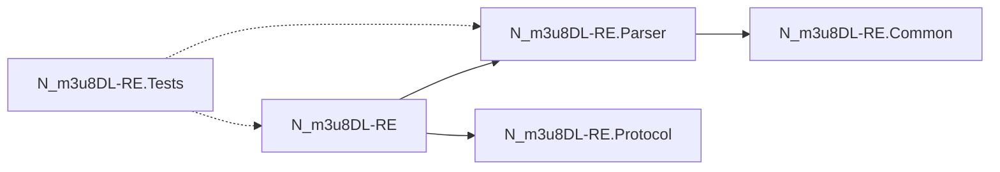
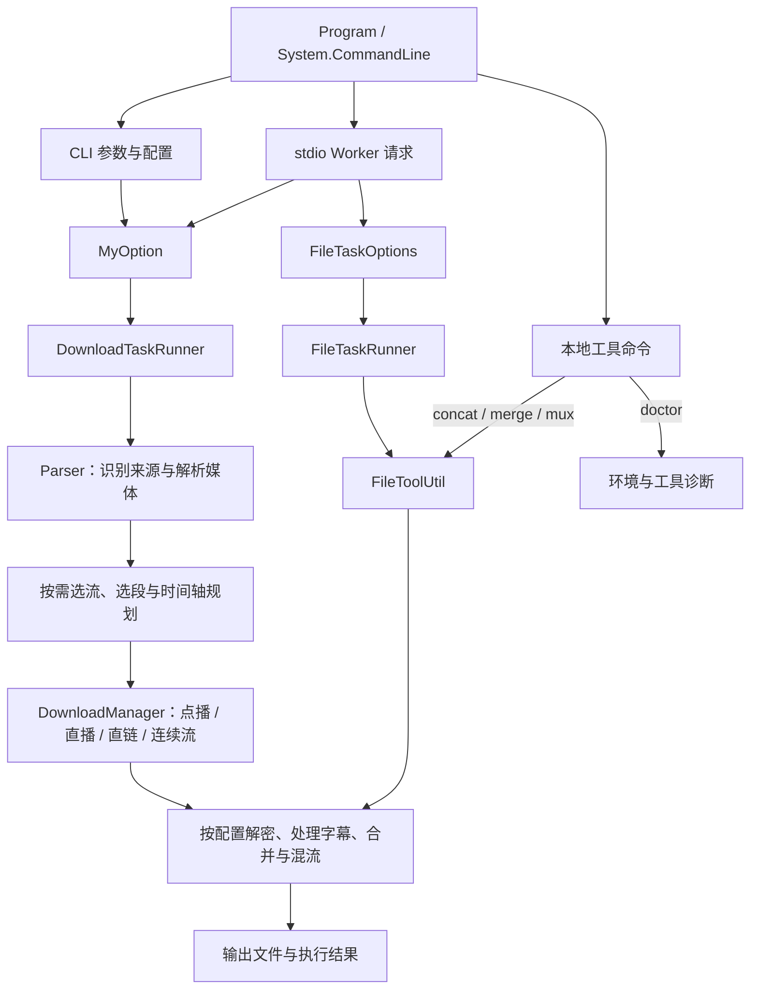

# 项目组织与任务流程

N_m3u8DL-RE 提供流媒体下载、直播录制和本地媒体处理。CLI 与 stdio Worker 共用任务执行流程。

## 仓库结构

```text
N_m3u8DL-RE/
├── docs/
│   ├── development/                 项目组织与任务流程
│   ├── api/                         Worker API 参考与 Schema
│   ├── usage/                       功能使用与通信协议
│   └── examples/                    可运行的调用示例
├── tools/WorkerApiDocs.cs            API 文档生成与检查（.NET 10 单文件应用）
└── src/
    ├── N_m3u8DL-RE.sln              解决方案
    ├── N_m3u8DL-RE/                 主程序、任务编排、下载与媒体处理
    ├── N_m3u8DL-RE.Parser/          来源识别与清单、容器解析
    ├── N_m3u8DL-RE.Common/          公共媒体模型、网络、日志和资源
    ├── N_m3u8DL-RE.Protocol/        请求、事件、交互和结果 DTO
    └── N_m3u8DL-RE.Tests/           单元与集成测试
```

## 项目依赖

实线表示产品项目引用，虚线表示测试引用。



主程序通过 Parser 使用 Common；Protocol 不依赖其他产品项目。Runtime 位于主程序内。

## 主程序分工

| 目录 / 入口 | 职责与关键实现 |
| --- | --- |
| `Program.cs`、`CommandLine/` | 命令分派、配置和参数解析；`CommandInvoker` 定义 CLI 选项，`MyOption` 承载执行配置 |
| `ConsoleUI/`、`Column/` | 终端选择、进度展示 |
| `Worker/` | `WorkerHost` 管理会话，`StdioTransport` 传输 JSON 行，`ProtocolMapper` 适配协议与内部数据 |
| `Runtime/` | `DownloadTaskRunner` / `FileTaskRunner` 分别编排下载与文件任务，共用执行上下文、取消和结果封装 |
| `DownloadManager/` | 点播、分片直播、直链文件与 HTTP 连续流的调度和收尾 |
| `Downloader/` | 分片获取、缓存、重试与校验 |
| `Crypto/`、`Util/` | 解密、选段与时间轴规划、字幕处理、合并混流和外部工具调用 |
| `Config/`、`Entity/`、`Enum/` | 下载配置、运行数据及执行模式 |
| `Processor/` | 解析处理器扩展示例 |

Parser 将不同格式转换为 Common 中的 `StreamSpec → Playlist → MediaPart → MediaSegment`；下载与处理模块围绕这组统一媒体模型工作。

## 任务流程



- CLI 与 Worker 通过 `IUserInteraction`、`ITaskObserver` 适配选择、状态和进度；下载请求引用 CLI 的 `Option` 定义；文件请求使用结构化输入，共用文件工具执行层和输入输出保护。
- Worker 一任务一进程；多个任务的队列、并发和历史由调用程序管理。取消会中断任务，直播正常停止会执行录制收尾。
- 主程序使用 Native AOT 发布；FFmpeg、mkvmerge 和解密工具按配置以外部进程运行。

字段定义见 [Worker API](../api/worker/README.md)，通信约定见 [stdio Worker 使用指南](../usage/stdio-worker.md)，接入示例见 [Python 客户端](../examples/README.md)。
