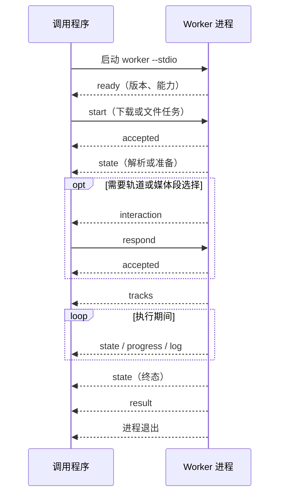

# stdio Worker 使用指南

完整字段定义和 JSON Schema 见 [Worker API 参考](../api/worker/README.md)。本文说明消息如何交互、进度如何合并及任务如何结束。

## 启动与进程约定

```bash
N_m3u8DL-RE worker --stdio
```

每个进程只接受一个任务，完成后退出。一次作业可以包含多条轨道和多个并发分片。

Worker 支持下载、录制及独立的 `concat`、`merge`、`mux` 文件处理任务。`doctor --json` 输出一次性诊断报告，不属于 Worker 任务。

- stdin：UTF-8、每行一条 JSON 命令；支持 LF 和 CRLF。
- stdout：UTF-8、无 BOM、每行一条 JSON 事件，不包含终端进度或普通文本。
- stderr：诊断输出，客户端应持续读取。
- Worker 不加载 CLI 配置文件。`start.request` 未指定的下载字段使用 CLI 默认值。
- 每行输入最多 1,048,576 个 UTF-16 字符。过长或缺少行尾的消息会结束会话；非法 JSON 与未知字段返回错误。
- 客户端应读取 `ready`，确认协议版本后再发送 `start`。

## 命令与事件

所有命令必须包含唯一、非空、最长 128 字符的 `id`。一次进程最多接受 4096 个不同命令 ID；被拒绝命令的 ID 也不能复用。

事件中的 `sequence` 从 1 开始递增，表示实际发送顺序。

| 方向 | type | 说明 |
| --- | --- | --- |
| Worker → 客户端 | `ready` | 协议版本、程序版本和能力 |
| 客户端 → Worker | `start` | `protocolVersion: 1`，以及下载或文件处理配置 |
| Worker → 客户端 | `accepted` | 用 `commandId` 确认命令已接收 |
| Worker → 客户端 | `error` | 命令错误；通常可以继续发送有效命令 |
| Worker → 客户端 | `state` | 状态与执行阶段 |
| Worker → 客户端 | `tracks` | 本次执行轨道，与进度中的轨道 ID 对应 |
| Worker → 客户端 | `progress` | 轨道下载、录制或后处理进度 |
| Worker → 客户端 | `interaction` | 待选择的轨道或点播分段 |
| 客户端 → Worker | `respond` | `interactionId` 和 `selectedIds` |
| 客户端 → Worker | `stop` | 正常结束直播录制 |
| 客户端 → Worker | `cancel` | 取消当前任务 |
| Worker → 客户端 | `log` | 可显示的日志，带 `level` 和 `message` |
| Worker → 客户端 | `result` | 最终结果和产物，是最后一条事件 |

`accepted` 不代表任务或控制动作已经完成。`error` 中的 `invalid_message` 表示消息结构不合法，`invalid_command` 表示当前命令或配置不被接受。

## 会话与事件时序



图示表达交互关系，不要求每个任务都产生相同消息或严格按图中的轨道顺序执行。多个轨道的状态、进度和日志可以交错。

| 命令 | 条件与必要字段 |
| --- | --- |
| `start` | `protocolVersion` 必须匹配 `ready`；下载使用 `request`，文件任务使用 `operation` 和 `fileRequest`，两种配置不能同时发送 |
| `respond` | 使用待处理的 `interactionId`，提交非空、无重复的 `selectedIds` |
| `cancel` | 任务已启动；确认后等待 `result.status = cancelled` 和进程退出 |
| `stop` | 已进入直播录制；确认后等待正常收尾结果 |

配置在任务启动前被拒绝时返回 `error`，可用新的命令 ID 重试。任务启动后的执行错误通过 `result.status = failed` 和 `result.error` 返回。

`state` 的终态不表示管道已经结束：缓冲的进度或日志可以在 `result` 前发送。客户端应读取到 `result`，再等待进程退出；管道失联或崩溃时可能没有 `result`。

## 最小任务示例

Worker 首先发送：

```json
{"type":"ready","sequence":1,"protocolVersion":1,"programVersion":"...","capabilities":["progress","selection","cancel","stop","binary","hls","dash","mss","httpLive","iptv","concat","merge","mux"]}
```

客户端提交任务：

```json
{"type":"start","id":"start-1","protocolVersion":1,"request":{"input":"https://example.com/video.m3u8","saveDir":"/downloads","saveName":"video","autoSelect":true,"noLog":true}}
```

成功完成：

```json
{"type":"result","sequence":18,"result":{"status":"succeeded","outputs":[{"path":"/downloads/video.mp4","size":123456}]}}
```

示例序号仅作演示，实际日志和状态数量取决于输入。

## 下载任务配置

`start.operation` 省略或设为 `download` 时，下载配置放在 `start.request`。

字段名区分大小写，采用 camelCase。除了 `input` 必填，其余字段可省略或为 null；布尔字段省略时沿用 CLI 默认值。完整字段清单见 [TaskRequest](../api/worker/models.md#taskrequest)，常用配置分组如下。

| 配置组 | 字段 |
| --- | --- |
| 输入与输出 | `input`、`saveDir`、`tmpDir`、`saveName`、`savePattern` |
| 请求配置 | `headers`、`cookies`、`baseUrl`、`appendUrlParams`、`httpRequestTimeout`、`httpVersion`、`urlProcessorArgs` |
| 网络 | `customProxy`、`useSystemProxy`、`networkInterface` |
| 选择 | `autoSelect`、`subOnly`、`selectVideo`、`selectAudio`、`selectSubtitle`、`dropVideo`、`dropAudio`、`dropSubtitle`、`vodSelectParts`、`vodDropParts`、`vodListParts` |
| 下载 | `threadCount`、`downloadRetryCount`、`maxSpeed`、`concurrentDownload`、`customRange`、`adKeywords`、`checkSegmentsCount`、`taskStartAt` |
| 合并与处理 | `skipMerge`、`skipDownload`、`binaryMerge`、`ffmpegConcatMode`、`writeMetaJson`、`delAfterDone`、`muxAfterDone`、`muxImports`、`subFormat`、`autoSubtitleFix`、`noDateInfo` |
| 工具与解密 | `ffmpegBinaryPath`、`decryptionBinaryPath`、`decryptionEngine`、`keys`、`keyTextFile`、`mp4RealTimeDecryption` |
| HLS 配置 | `customHlsMethod`、`customHlsKey`、`customHlsIv`、`customHlsScope`、`allowHlsMultiExtMap` |
| 直播 | `livePerformAsVod`、`liveRealTimeMerge`、`livePipeMux`、`liveFixVttByAudio`、`liveKeepSegments`、`liveRecordLimit`、`liveWaitTime`、`liveIdleTimeout`、`liveTakeCount`、`liveCatchup` |
| 日志 | `logFilePath`、`logLevel`、`noLog` |

- `headers` 是字符串字典；`keys`、`adKeywords`、`muxImports` 是字符串数组。`muxImports` 每项使用 CLI 的文件路径或 `path=文件:lang=en:name=English` 格式，需配合 `muxAfterDone` 使用；文件须在 Worker 所在机器上存在。
- `maxSpeed` 是正整数，单位为字节/秒。
- `httpRequestTimeout` 单位为秒。显式设置会保留“手动指定”标记，供直播超时策略使用。
- `httpVersion` 使用 CLI 的 `1.1` 或 `2` 取值。
- `decryptionEngine`、`muxAfterDone`、流筛选、范围和直播时长等沿用相应 CLI 参数语法。
- `threadCount`、直播间隔和计数必须为正，重试次数允许为 0。
- `cookies`、工具路径和输出路径均指 Worker 所在机器的路径；相对路径基于 Worker 工作目录。
- 任务配置使用 CLI 的取值和解析规则：`customHlsKey`、`customHlsIv` 支持文件路径、HEX 和 Base64；`customHlsScope` 为 `ALL`、`VIDEO` 或 `AUDIO`；`subFormat` 为 `SRT` 或 `VTT`；`ffmpegConcatMode` 为 `LOCAL_HTTP`、`PROTOCOL` 或 `DEMUXER`。
- `taskStartAt` 使用 Worker 本地时间，格式为 `yyyyMMddHHmmss`。等待开始期间可以发送 `cancel`；相对直播回看起点在调度等待结束后计算。
- `livePipeMux` 使用 FFmpeg 边录制边混流，并自动启用 `liveRealTimeMerge`。默认文件输出在混流成功后列入 `result.outputs`；通过环境变量配置的推流目标可能没有本地文件产物。
- `vodListParts` 将点播分段列表作为日志输出后结束；需要结构化选择时使用 `vodSelectParts` 和 `interaction.kind = parts`。
- `logLevel` 可设为 `OFF`、`ERROR`、`WARN`、`INFO`、`DEBUG`；`noLog` 控制日志文件写入。状态和进度事件不依赖日志级别。
- 下载请求支持的字段以 API 参考为准；未知字段会明确报错，不会静默忽略。
- `skipDownload` 完成解析与选择后结束，通常没有输出文件；`skipMerge` 的结果包含保留下来的下载文件。分片直播关闭实时合并时，结果会列出保留的初始化文件和媒体分片。

例如，指定 HLS 解密配置、丢弃音轨并输出 VTT 字幕：

```json
{"type":"start","id":"hls-1","protocolVersion":1,"request":{"input":"https://example.com/video.m3u8","autoSelect":true,"customHlsMethod":"AES_128","customHlsKey":"00112233445566778899aabbccddeeff","customHlsIv":"ffeeddccbbaa99887766554433221100","customHlsScope":"VIDEO","dropAudio":"lang=fr:for=all","subFormat":"VTT","mp4RealTimeDecryption":true,"urlProcessorArgs":"custom=value","noLog":true}}
```

帮助、补全、配置文件和终端显示开关属于 CLI 启动配置；Worker 的任务配置通过 `request` 提交。`--ui-language` 可在启动 Worker 时指定。旧 CLI 开关 `--use-shaka-packager` 和 `--use-ffmpeg-concat-demuxer` 分别通过 `decryptionEngine: "SHAKA_PACKAGER"` 和 `ffmpegConcatMode: "DEMUXER"` 表达。

## 独立文件处理任务

在 `start` 中设置 `operation: "concat" | "merge" | "mux"`，配置放在 `fileRequest`，此时不能同时发送下载用的 `request`。

```json
{"type":"start","id":"join-1","protocolVersion":1,"operation":"merge","fileRequest":{"inputs":[{"path":"/media/part1.mp4"},{"path":"/media/part2.mp4"}],"output":"/media/joined.mp4","concatMode":"DEMUXER"}}
```

| CLI 配置 | Worker 字段 | 用途 |
| --- | --- | --- |
| `-i` / `--input`、`--input-dir` | `inputs` | 必填、有序数组；每项用 `path` 指定文件或目录，可混合录制目录和独立文件 |
| `--mux-import` | 追加到 `inputs` | 仅 `mux`；外部音轨、字幕等同样作为输入，可附带 `language`、`name` |
| `-o` / `--output` | `output` | 必填，输出路径；相对路径基于 Worker 工作目录 |
| `--pattern` | `pattern` | 目录内的文件筛选，如 `*.ts`；省略时自动识别录制轨道和媒体文件 |
| `--overwrite` | `overwrite` | 默认 false；允许覆盖时也只在处理成功后替换原输出 |
| `--dry-run` | `dryRun` | 默认 false；只校验和预览，结果的 `outputs` 为空 |
| `--ffmpeg-binary-path` | `ffmpegBinaryPath` | `merge`、`mux` 的 FFmpeg 路径；省略时自动查找 |
| `--ffmpeg-concat-mode` | `concatMode` | 仅 `merge`：`LOCAL_HTTP`、`PROTOCOL`、`DEMUXER`；省略时根据输入选择 |
| `--muxer`、`--mkvmerge-binary-path` | `muxer`、`mkvmergeBinaryPath` | 仅 `mux`；混流器默认 `ffmpeg`，也支持 `mkvmerge` |
| `--auto-subtitle-fix`、`--title` | `autoSubtitleFix`、`title` | 仅 `mux`；字幕时间轴修复默认开启，可指定输出标题 |

独立 `mux` 将 CLI 的 `-i` 与 `--mux-import` 合并为同一个 `inputs` 数组，按照数组顺序处理。每项的 `language` 对应 CLI 的 `lang`，`name` 对应轨道标题；也可以全部使用外部文件输入。

例如，以下 CLI 命令与后面的 Worker 请求等价：

```bash
N_m3u8DL-RE mux -i /media/video.mp4 --mux-import "path=/media/english.srt:lang=en:name=English subtitles" -o /media/movie.mkv --muxer mkvmerge
```

```json
{"type":"start","id":"mux-1","protocolVersion":1,"operation":"mux","fileRequest":{"inputs":[{"path":"/media/video.mp4"},{"path":"/media/english.srt","language":"en","name":"English subtitles"}],"output":"/media/movie.mkv","muxer":"mkvmerge"}}
```

下载完成后追加外部轨道时，使用 `request.muxAfterDone` 和字符串数组 `request.muxImports`；独立文件混流则使用 `operation: "mux"` 和结构化的 `fileRequest.inputs`。

文件任务复用相同的状态、日志、进度和最终结果事件。`tracks` 中编号 `0` 表示本次文件处理，`progress` 使用后处理字段；`cancel` 会中断文件复制或外部工具，并清理本次中间文件。文件任务不支持 `stop`。

输入输出冲突、目录解析、格式和覆盖检查与 CLI 共用。不能用于当前操作的字段会明确报错；文件不存在或工具执行失败等运行错误通过 `result` 返回。每个 Worker 只接受一次成功校验的 `start`。

## 轨道与分段选择

没有自动选择或筛选规则时，Worker 根据输入发送 `interaction`。多分段点播可能先请求 `parts`，再请求 `streams`。

```json
{"type":"interaction","sequence":7,"interaction":{"id":"selection-id","kind":"streams","choices":[{"id":"0","label":"视频轨道","mediaType":"video","resolution":"1920x1080"}],"defaultIds":["0"]}}
```

客户端回复：

```json
{"type":"respond","id":"reply-1","interactionId":"selection-id","selectedIds":["0"]}
```

选项 ID 仅在当前交互中有效，必须非空、无重复且全部属于候选项。过期 ID 或错误选项会返回 `error`，可重新回复同一有效交互。每次交互最多等待 30 分钟，也可通过 `cancel` 提前结束。

`parts` 的候选项还包含 `partIds` 和 `durationSeconds`。`defaultIds` 提供建议选项，GUI 可以展示后交给用户确认。

最终的 `tracks` 消息给出本次执行的轨道编号和摘要；这些编号用于匹配 `progress.trackId`，与交互中临时的候选项编号分别使用。

## 状态与进度

### 状态与阶段

`state.status`：

| 状态 | 含义 |
| --- | --- |
| `running` | 正在解析、下载、录制或处理文件 |
| `waitingForInput` | 等待 `respond`，也可通过 `cancel` 结束任务 |
| `stopping` | 已请求停止或取消，正在退出执行链及收尾 |
| `succeeded` / `failed` / `cancelled` | 执行终态；详细结果及产物见 `result` |

`state.phase` 使用 `analyzing`、`downloading`、`preparing`、`decrypting`、`subtitles`、`merging`、`muxing`、`finalizing`、`finished` 表达阶段。`progress.phase` 报告对应轨道的下载或后处理阶段。

任务级 `state.phase` 表示最近报告的阶段。并发轨道可能分别处于下载、解密或合并阶段，轨道显示应使用各自的 `progress.phase`。阶段不是统一的线性百分比；多段媒体处理中也可能再次进入下载或合并。

### 上报频率与顺序

- 分片下载和录制约每秒采样；直链文件随传输回调上报，通常按约 500 毫秒节流。
- 同轨道、同阶段的高频报告还会按约 250 毫秒节流；完成进度可直接上报。待发送进度按轨道合并，客户端可能只收到一批更新中的最新状态。
- 这些间隔不是固定刷新或心跳保证。等待网络、用户输入或外部工具时，可能没有新的有效进度。
- `sequence` 表示实际发送顺序，不是分片编号或采样编号；不能根据消息数量推算下载量、耗时或完成比例。
- `progress.trackId` 对应 `tracks` 的编号，作用域为一个 Worker 任务；交互选择的候选编号单独使用。独立文件任务使用编号 `0`，下载后的整体混流也可能复用 `0`。

### 进度字段与单位

完整类型定义见 [TaskProgress](../api/worker/models.md#taskprogress)。数值为 0 与字段省略具有不同含义。

| 字段 | 单位 / 含义 | 界面处理建议 |
| --- | --- | --- |
| `downloadedBytes` | 字节；当前有效下载数据 | 重试回退或媒体段切换时可以减小，不要求单调增加 |
| `receivedBytes` | 字节；下载器统计的接收数据，包含重试流量 | 与有效下载大小分开使用；缓存数据也可能使二者不同 |
| `totalBytes` | 字节；已知的总文件大小 | 未知时不显示字节百分比 |
| `speedBytesPerSecond` | 字节/秒；采样速度 | 除以 1024 转换为 KiB/s；0 表示本次报告零速 |
| `completedSegments` / `totalSegments` | 分片个数 | 表达分片进度，不等同于字节百分比；直播总量通常未知 |
| `recordedSeconds` | 秒；录制器统计的录制时长 | 分片直播累计媒体分片时长，HTTP 连续流使用录制计时；不是精确探测出的产物时长 |
| `fraction` | 当前轨道、当前阶段的比例，通常为 0～1 | 显示时限制到 0～100%；工具估计可能有偏差，省略时显示不定进度 |
| `processedBytes` | 字节；当前处理阶段报告的处理量 | 不加到网络下载字节上 |
| `processedSeconds` | 秒；工具报告的已处理媒体时长 | 不是外部工具运行耗时 |

直播没有有限总量时，不报告确定的完成比例。工具不能可靠推算处理时长时，也可以只报告处理字节或阶段名称。多个轨道、分片和后处理阶段的计量单位不同，不应直接平均成一个总百分比。

### 下载、直播和后处理示例

分片点播：有效下载 1 MiB，已完成 2/20 个分片，当前阶段进度为 10%。

```json
{"type":"progress","sequence":10,"progress":{"trackId":"0","phase":"downloading","downloadedBytes":1048576,"receivedBytes":1114112,"speedBytesPerSecond":524288,"completedSegments":2,"totalSegments":20,"fraction":0.1}}
```

直播：已录制 42.5 秒，没有有限的总分片数和百分比；此次报告速度为 0。

```json
{"type":"progress","sequence":11,"progress":{"trackId":"0","phase":"downloading","downloadedBytes":20971520,"receivedBytes":20971520,"speedBytesPerSecond":0,"completedSegments":14,"recordedSeconds":42.5}}
```

后处理：混流已处理到 30 秒，比例为 60%；下载统计没有更新。

```json
{"type":"progress","sequence":12,"progress":{"trackId":"0","phase":"muxing","processedBytes":8388608,"processedSeconds":30,"fraction":0.6}}
```

### 局部更新与阶段切换

- 下载字节、接收字节、速度及分片统计省略时，保留界面已有值；不能按 0 覆盖。
- `fraction` 省略表示当前进度未知，应切换为不定进度；不能沿用上一条百分比。
- 阶段切换时清空上一阶段的处理百分比、处理字节和处理时长；累计下载统计单独保存。
- 同一阶段内，省略的 `processedBytes`、`processedSeconds` 可保留已有值。
- 日志队列饱和时会丢弃旧日志，界面应依据状态、进度和结果事件更新。

下面的 Python 示例展示合并规则，完整显示逻辑见 [示例客户端](../examples/stdio_client.py)。

```python
DOWNLOAD_FIELDS = (
    "downloadedBytes", "receivedBytes", "totalBytes", "speedBytesPerSecond",
    "completedSegments", "totalSegments", "recordedSeconds",
)


def apply_progress(cache, patch):
    track = cache.setdefault(patch["trackId"], {
        "phase": None, "download": {}, "processing": {},
    })
    if track["phase"] != patch["phase"]:
        track["processing"].clear()
    track["phase"] = patch["phase"]
    for key in DOWNLOAD_FIELDS:
        if patch.get(key) is not None:
            track["download"][key] = patch[key]
    current = track["download"] if patch["phase"] == "downloading" else track["processing"]
    for key in ("processedBytes", "processedSeconds"):
        if patch.get(key) is not None:
            current[key] = patch[key]
    current["fraction"] = patch.get("fraction")
```

### 完成判定

`fraction = 1` 只表示当前阶段报告完成。FFmpeg 报告结束后，Worker 还需等待退出码、检查产物、提交文件及清理目录。只有 `result.status = succeeded` 才表示任务成功；客户端还应核对进程退出码。停止或取消命令的 `accepted` 同样只表示接收命令。

## 第三方工具输出

子进程的 stdout、stderr 均由主程序捕获，不会直接混入 Worker 的协议 stdout。

- FFmpeg 的 `-progress` 输出转换为 `progress` 事件；合并、混流和解密工具的 stderr 通常逐行转换为 `log` 事件，统一使用 `warn`，不代表每行都是工具自身的警告。
- mkvmerge 的 GUI 进度转换为 `progress`，GUI 警告和错误转换为 `log`；下载后的混流路径会抑制普通信息输出。
- 媒体信息、版本和 KID 探测的输出用于内部解析；解密工具的 stdout 也未统一转换为日志事件，因此并非所有原始输出都会展示。
- 未经过 Logger 的遗留文本和额外诊断写到 Worker 的 stderr。客户端应同时读取协议 stdout 和诊断 stderr，并通过 `result` 与退出码判断任务成败。

## 停止、取消与退出

```json
{"type":"stop","id":"stop-1"}
{"type":"cancel","id":"cancel-1"}
```

`stop` 只在进入直播执行后有效：分片直播停止刷新并处理已排队分片，HTTP 连续流结束当前读取，然后保存和收尾。成功收尾的状态是 `succeeded`。

`cancel` 中断请求、等待及外部工具，最终状态是 `cancelled`。命令行库触发的取消信号也进入同一执行链，命令行信号处理最多等待 15 秒供执行链退出。stdin EOF 或协议管道失联也会发出取消信号；关闭浏览器是否影响任务，取决于哪个程序持有 Worker 管道。

stdout 写入持续阻塞超过 10 秒或关键事件队列饱和，会结束通信会话。此时最终结果可能无法交付。父进程须设置自己的退出等待上限，并在必要时终止 Worker 及其子进程。

| 退出码 | 含义 |
| --- | --- |
| 0 | 任务成功 |
| 1 | 任务失败、通信故障或未启动任务即结束会话 |
| 2 | 已启动任务被取消 |

有 `result` 时，应同时检查结果与退出码。异常崩溃或强制终止可能没有最终结果。

## 客户端示例

[Python 客户端示例](../examples/README.md) 演示了清晰度、音轨及分段选择，下载与后处理进度展示，以及录制停止和取消。
